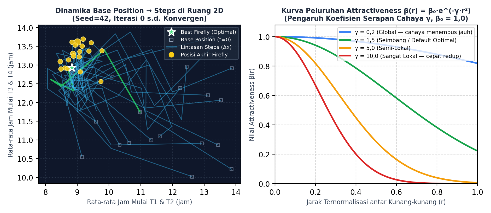
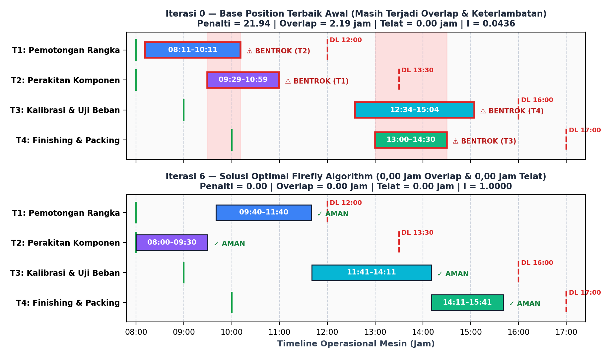
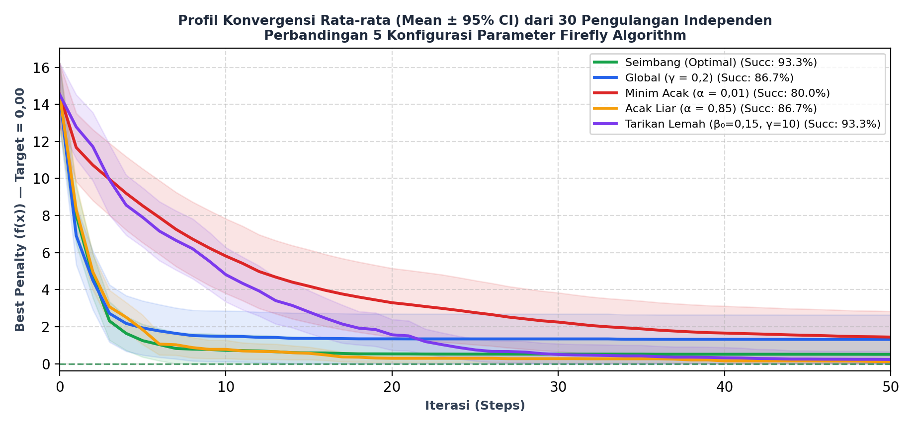
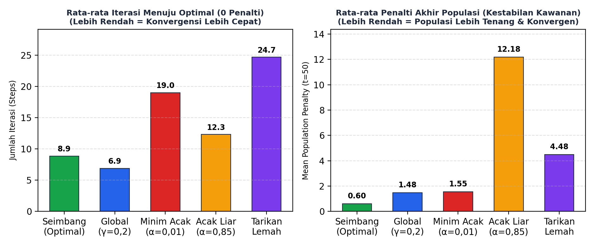
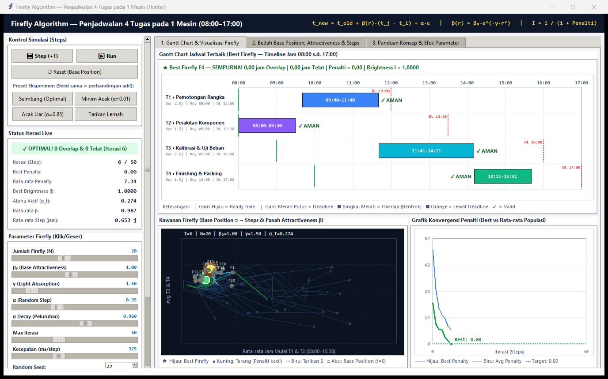
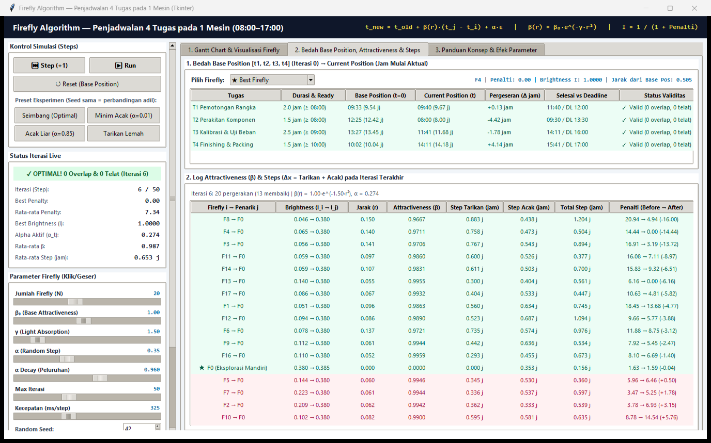

# Optimasi Penjadwalan 4 Tugas pada 1 Mesin Menggunakan Firefly Algorithm (FA)

**Bio-Inspired Computing | Single-Machine Scheduling Problem (Anti-Overlap & Anti-Keterlambatan) | Pure Python + Tkinter**

> **Ringkasan Eksekutif**  
> Proyek ini menyajikan perancangan, implementasi, dan analisis sensitivitas parameter algoritma metaheuristik *bio-inspired computing*—**Firefly Algorithm (FA)**—pada permasalahan penjadwalan 4 tugas produksi pada 1 mesin (*Single-Machine Scheduling Problem*) dalam jam kerja **08:00 s.d. 17:00** (9,0 jam operasional untuk total beban kerja 7,5 jam). Setiap kunang-kunang (*firefly*) merepresentasikan satu calon jadwal secara langsung sebagai vektor posisi kontinu 4 dimensi $x_i = [t_1, t_2, t_3, t_4]$ yang menyatakan jam mulai aktual tiap tugas, dengan tujuan meminimalkan penalti gabungan dari tumpang tindih waktu mesin (*overlap*) dan keterlambatan terhadap tenggat waktu (*lateness*) menuju **0,00** (kecerahan maksimum $I = 1,0000$).  
>  
> Pengujian komputasi dilakukan sebanyak **30 pengulangan independen** pada **5 konfigurasi parameter** guna membedah pengaruh nyata dari **Base Position**, **Attractiveness ($\beta_0, \gamma$)**, dan **Steps ($\alpha, \alpha_{\text{decay}}$)**. Konfigurasi seimbang ($N=20, \beta_0=1,0, \gamma=1,5, \alpha=0,35, \alpha_{\text{decay}}=0,96$) mencapai tingkat keberhasilan optimal tertinggi sebesar **93,3% (28/30 uji)** dengan rata-rata konvergensi hanya **8,9 iterasi**, rata-rata penalti populasi akhir **0,60**, dan waktu komputasi **28,31 ms**. Seluruh proses divisualisasikan secara real-time melalui aplikasi desktop murni **Python + Tkinter** (tanpa dependensi eksternal).

---

## Cara Menjalankan Aplikasi Tkinter

Pastikan Python 3.9+ (dengan modul standar `tkinter`) sudah terpasang, lalu jalankan:

```bash
python app_tkinter.py
```

Tidak diperlukan instalasi paket eksternal apa pun untuk menjalankan `firefly_scheduler.py` dan `app_tkinter.py`.

### Struktur Proyek

```text
firefly-algorithm-problem/
├── firefly_scheduler.py   # Model penjadwalan 4 tugas & mesin Firefly Algorithm (pure Python stdlib)
├── app_tkinter.py         # Aplikasi desktop Tkinter interaktif (Gantt Chart, Swarm 2D, Grafik, Bedah Step)
├── assets/                # Grafik hasil eksperimen 30 runs & tangkapan layar aplikasi Tkinter
├── .gitignore             # Mengabaikan file *.docx dan cache Python
└── README.md              # Dokumentasi & laporan lengkap
```

---

## 1. Pendahuluan

### 1.1 Latar Belakang
Permasalahan penjadwalan (*Scheduling Problem*) merupakan salah satu persoalan optimasi fundamental pada bidang manufaktur, operasi layanan, dan komputasi. Pada lingkungan satu mesin (*single-machine scheduling*), beberapa tugas harus dijadwalkan dalam jendela waktu operasional tanpa saling bertumpuk (*non-overlapping*) serta diselesaikan sebelum batas waktu (*deadline*). Penentuan jam mulai secara kontinu menghasilkan ruang pencarian yang memiliki banyak solusi layak sekaligus sejumlah jebakan optimum lokal (*multimodal*).

**Firefly Algorithm (FA)**, yang diperkenalkan oleh Xin-She Yang (2008), merupakan algoritma metaheuristik *bio-inspired computing* berbasis perilaku pancaran cahaya (*bioluminescence*) kunang-kunang. Dengan memetakan jam mulai 4 tugas secara langsung ke dalam vektor kontinu 4 dimensi, seluruh mekanisme inti FA—**Base Position**, **Light Intensity ($I$)**, **Attractiveness ($\beta$)**, dan **Steps ($\Delta x$)**—dapat diamati dan dijelaskan secara transparan tanpa lapisan *encoding* diskrit yang rumit.

### 1.2 Tujuan
1. Merumuskan model matematis penjadwalan 4 tugas pada 1 mesin secara kontinu beserta fungsi penalti *overlap*, keterlambatan, dan intensitas cahaya kunang-kunang.
2. Mengimplementasikan Firefly Algorithm murni menggunakan Python standard library dan membangun aplikasi visualisasi desktop interaktif berbasis Tkinter.
3. Menganalisis secara kuantitatif dan visual pengaruh **Base Position**, **Attractiveness ($\beta_0, \gamma$)**, dan **Steps ($\alpha, \alpha_{\text{decay}}$)** terhadap kecepatan konvergensi, kestabilan populasi, dan kualitas jadwal.
4. Membuktikan keseimbangan eksplorasi vs. eksploitasi FA melalui benchmark 30 pengulangan independen pada 5 skenario parameter.

### 1.3 Ruang Lingkup dan Asumsi
- Jumlah tugas: 4 tugas produksi (`T1`–`T4`) pada 1 unit mesin dalam jam operasional **08:00 – 17:00** (9,0 jam).
- Setiap tugas bersifat *non-preemptive* (sekali dimulai harus diselesaikan penuh sesuai durasinya tanpa dijeda).
- Mesin hanya dapat memproses 1 tugas pada satu waktu (*no overlap*).
- Setiap tugas memiliki batas mulai paling awal (*ready time*) dan batas selesai maksimal (*deadline*) yang tetap.

---

## 2. Data dan Deskripsi Studi Kasus Penjadwalan

Total durasi pengerjaan keempat tugas adalah **7,5 jam** di dalam jendela kerja **9,0 jam** (kelonggaran/*slack* total 1,5 jam). Hal ini menjamin keberadaan solusi optimal bernilai penalti **0,00**, sementara penyebaran acak awal (*Base Position*) hampir selalu menimbulkan bentrok jadwal maupun keterlambatan.

### Tabel 1. Spesifikasi 4 Tugas Produksi pada 1 Mesin

| Kode & Nama Tugas | Durasi | Ready Time | Deadline | Rentang Jam Mulai Valid |
| :--- | :---: | :---: | :---: | :---: |
| **T1 — Pemotongan Rangka** | 2,0 jam | 08:00 | 12:00 | 08:00 – 15:00 (7,0 j) |
| **T2 — Perakitan Komponen** | 1,5 jam | 08:00 | 13:30 | 08:00 – 15:30 (7,5 j) |
| **T3 — Kalibrasi & Uji Beban** | 2,5 jam | 09:00 | 16:00 | 09:00 – 14:30 (5,5 j) |
| **T4 — Finishing & Packing** | 1,5 jam | 10:00 | 17:00 | 10:00 – 15:30 (5,5 j) |

---

## 3. Perumusan Model Matematis dan Fungsi Kecerahan

### 3.1 Variabel Keputusan & Base Position ($x_i$)
Setiap kunang-kunang ke-$i$ ($i = 1, \dots, N$) mewakili satu jadwal lengkap sebagai vektor 4 angka kontinu jam mulai:

$$x_i = \begin{bmatrix} t_{i,1}, & t_{i,2}, & t_{i,3}, & t_{i,4} \end{bmatrix}, \quad t_{i,k} \in [\text{ready}_k,\; 17{,}0 - \text{dur}_k]$$

Pada iterasi $t = 0$, seluruh posisi awal $x_i^{(0)}$ dibangkitkan acak merata di rentang validnya—inilah **Base Position**. Waktu selesai setiap tugas adalah $\text{end}_{i,k} = t_{i,k} + \text{dur}_k$.

### 3.2 Fungsi Penalti (Cost Function)
Kualitas jadwal dihitung dari 2 pelanggaran kontinu:

1. **Overlap (Bentrok Mesin, bobot $w_{\text{ov}} = 10{,}0$ per jam):**
   $$\text{Overlap}(x_i) = \sum_{a < b} \max\Big(0,\; \min(\text{end}_a, \text{end}_b) - \max(t_a, t_b)\Big)$$

2. **Lateness (Keterlambatan terhadap Deadline, bobot $w_{\text{late}} = 6{,}0$ per jam):**
   $$\text{Lateness}(x_i) = \sum_{k=1}^{4} \max\big(0,\; \text{end}_k - \text{deadline}_k\big)$$

3. **Total Penalti (Target = 0,00):**
   $$f(x_i) = 10{,}0 \cdot \text{Overlap}(x_i) + 6{,}0 \cdot \text{Lateness}(x_i)$$

### 3.3 Intensitas Cahaya / Brightness ($I$)
Penalti dikonversi menjadi tingkat kecerahan kunang-kunang:

$$I(x_i) = \frac{1}{1 + f(x_i)} \in (0, 1]$$

- Penalti = `0,00` (bebas bentrok & tepat deadline) $\rightarrow$ $I = 1{,}0000$ (**paling terang**).
- Penalti tinggi (misal `21,94`) $\rightarrow$ $I = 0{,}0436$ (**redup**).

---

## 4. Perancangan Firefly Algorithm & Efek Parameter

### 4.1 Mekanisme Inti FA (Base Position, Attractiveness, Steps)
Pada setiap iterasi, setiap kunang-kunang $i$ mencari kunang-kunang lebih terang $j$ ($I_j > I_i$) dengan daya tarik efektif terbesar ($\beta(r_{ij}) \cdot I_j$), lalu memperbarui posisi jam mulainya:

1. **Jarak Euclidean Ternormalisasi ($r_{ij} \in [0, 1]$):**
   $$r_{ij} = \sqrt{\frac{1}{4}\sum_{k=1}^{4}\left(\frac{t_{i,k} - t_{j,k}}{\text{span}_k}\right)^2}$$

2. **Attractiveness ($\beta$):**
   $$\beta(r_{ij}) = \beta_0 \cdot e^{-\gamma r_{ij}^2}$$

3. **Steps / Update Posisi ($\Delta x$):**
   $$t_{i,k}^{(t+1)} = t_{i,k}^{(t)} + \underbrace{\beta(r_{ij})\cdot\big(t_{j,k}^{(t)} - t_{i,k}^{(t)}\big)}_{\text{Attraction Step (Eksploitasi)}} + \underbrace{\alpha_t \cdot (\text{rand} - 0{,}5) \cdot \text{span}_k}_{\text{Random Step (Eksplorasi)}}$$

4. **Peluruhan Langkah Acak ($\alpha_{\text{decay}}$) & Elitisme:**  
   $\alpha_{t+1} = \max(0{,}02,\; \alpha_t \times \alpha_{\text{decay}})$ agar eksplorasi luas di awal lalu halus (*fine-tuning*) di akhir, disertai elitisme ringan serta eksplorasi lokal *greedy* pada kunang-kunang paling terang.


*Gambar 1. (Kiri) Proyeksi 2D dinamika perpindahan dari Base Position ($\square$) melalui lintasan Steps menuju Best Firefly ($\star$) pada Seed 42; (Kanan) Kurva peluruhan fungsi Attractiveness $\beta(r)$ terhadap jarak $r$ untuk berbagai nilai koefisien serapan cahaya $\gamma$.*

### 4.2 Pemetaan Efek Parameter (Ngefek ke Mana dan Bagaimana?)

| Komponen / Parameter | Target Pengaruh Utama | Jika Terlalu Kecil | Jika Terlalu Besar |
| :--- | :--- | :--- | :--- |
| **Base Position & $N$** | Keragaman jadwal awal & cakupan ruang cari | Variasi awal sempit; peluang langsung mendapat jadwal mendekati layak rendah | Cakupan ruang cari luas & stabil, tetapi waktu per iterasi meningkat |
| **$\beta_0$ (Base Attractiveness)** | Kekuatan tarikan maksimum saat $r \to 0$ (Eksploitasi) | Kunang-kunang redup lambat meniru jadwal terang; konvergensi sangat lambat | Tarikan agresif; berisiko melewati (*overshoot*) titik optimal jika $\beta_0 > 1$ |
| **$\gamma$ (Light Absorption)** | Radius pandang & redaman cahaya terhadap jarak | Cahaya menembus jauh (**Global**); cepat berkumpul tetapi rawan *premature convergence* | Cahaya cepat redup (**Lokal**); $\beta \to 0$ sehingga pencarian lambat/hampir acak |
| **$\alpha$ (Random Step)** | Skala goyangan acak pada jam mulai (Eksplorasi) | Kehilangan daya jelajah; mudah mentok di *local optimum* (masih bentrok/telat) | Jadwal melompat liar; penalti rata-rata populasi tinggi dan sulit tenang |
| **$\alpha_{\text{decay}}$ (Peluruhan)** | Transisi eksplorasi $\to$ *fine-tuning* | Langkah acak terlalu cepat mati sebelum eksplorasi tuntas | Mendekati `1,00` membuat osilasi acak bertahan terlalu lama di akhir iterasi |

---

## 5. Hasil Simulasi dan Analisis Eksperimen

### 5.1 Jejak Konvergensi Detail (Seed = 42, Konfigurasi Seimbang)
Pada **Iterasi 0 (Base Position)**, jadwal terbaik awal (`F4`) masih memiliki penalti **21,94** (2,19 jam *overlap*). Hanya dalam **6 iterasi**, Firefly Algorithm menata ulang jam mulai seluruh tugas menjadi **0,00 jam overlap & 0,00 jam telat** ($I = 1{,}0000$).

| Tugas | Jadwal Base Position ($t=0$) | Jadwal Optimal ($t=6$) | Pergeseran ($\Delta$ jam) | Evaluasi Deadline |
| :--- | :---: | :---: | :---: | :---: |
| **T1 (Pemotongan Rangka)** | 08:11 – 10:11 | 09:40 – 11:40 | +1,48 jam | DL 12:00 (Valid) |
| **T2 (Perakitan Komponen)** | 09:29 – 10:59 | 08:00 – 09:30 | -1,48 jam | DL 13:30 (Valid) |
| **T3 (Kalibrasi & Uji Beban)** | 12:34 – 15:04 | 11:41 – 14:11 | -0,88 jam | DL 16:00 (Valid) |
| **T4 (Finishing & Packing)** | 13:00 – 14:30 | 14:11 – 15:41 | +1,18 jam | DL 17:00 (Valid) |


*Gambar 2. Perbandingan Gantt Chart sebelum (Iterasi 0 — Base Position, Penalti 21,94) dan sesudah optimasi Firefly Algorithm (Iterasi 6 — 0,00 jam overlap & 0,00 jam telat).*

### 5.2 Benchmark Kuantitatif 30 Pengulangan Independen (5 Skenario)
Pengujian dilakukan sebanyak **30 independent runs** (`seed = 100..129`, 50 iterasi per run, $N = 20$) untuk membandingkan 5 skenario parameter secara adil.

| Skenario Parameter | Best Penalty | Mean $\pm$ Std | Pop Avg ($t=50$) | Success Rate (0 Pen.) | Avg Iterasi Optimal | Waktu (50 iter) |
| :--- | :---: | :---: | :---: | :---: | :---: | :---: |
| **Seimbang (Optimal)** (`β₀=1,0, γ=1,5, α=0,35`) | 0,00 | 0,51 $\pm$ 2,26 | **0,60** | **93,3% (28/30)** | 8,9 iter | 28,31 ms |
| **Global** (`γ=0,2`) | 0,00 | 1,31 $\pm$ 3,69 | 1,48 | 86,7% (26/30) | **6,9 iter** | 28,18 ms |
| **Minim Acak** (`α=0,01`) | 0,00 | 1,44 $\pm$ 3,88 | 1,55 | 80,0% (24/30) | 19,0 iter | 32,46 ms |
| **Acak Liar** (`α=0,85`) | 0,00 | 0,12 $\pm$ 0,37 | 12,18 | 86,7% (26/30) | 12,3 iter | 48,00 ms |
| **Tarikan Lemah** (`β₀=0,15, γ=10`) | 0,00 | 0,23 $\pm$ 1,19 | 4,48 | 93,3% (28/30) | 24,7 iter | 46,62 ms |


*Gambar 3. Profil kurva konvergensi rata-rata (Mean Best Penalty $\pm$ 95% Confidence Interval) dari 30 pengulangan independen pada 5 skenario parameter.*

### 5.3 Temuan Utama Analisis Sensitivitas
- **Seimbang (Optimal)** memberikan keseimbangan terbaik: tingkat keberhasilan tertinggi (**93,3%**), cepat konvergen (**8,9 iterasi**), dan populasi akhir paling tenang (`Pop Avg = 0,60`).
- **Global ($\gamma = 0,2$)** paling cepat saat berhasil (**6,9 iterasi**), namun keberhasilan turun ke **86,7%** karena hilangnya keragaman terlalu dini (*premature convergence*).
- **Minim Acak ($\alpha = 0,01$)** menghasilkan keberhasilan terendah (**80,0%**) dan mean penalti terburuk (`1,44 ± 3,88`) akibat terjebak *local optimum*.
- **Acak Liar ($\alpha = 0,85$)** membuat penalti rata-rata populasi berosilasi sangat tinggi (**12,18**, lebih dari 20× lebih liar dibanding konfigurasi seimbang).
- **Tarikan Lemah ($\beta_0 = 0,15, \gamma = 10$)** memperlambat konvergensi hampir **3× lipat** (**24,7 iterasi**) karena daya tarik $\beta$ teredam kuat oleh jarak.


*Gambar 4. Perbandingan kecepatan konvergensi (kiri) dan kestabilan rata-rata penalti populasi akhir (kanan) pada 5 skenario parameter.*

---

## 6. Implementasi Antarmuka Desktop Tkinter

Aplikasi `app_tkinter.py` menyediakan 3 tab utama yang memudahkan simulasi langsung sekaligus penjelasan konsep langkah demi langkah:

1. **Tab 1 — Gantt Chart & Visualisasi Firefly**: menampilkan pergeseran balok tugas `T1`–`T4` secara real-time, kanvas 2D kawanan kunang-kunang, dan grafik konvergensi.
2. **Tab 2 — Bedah Base Position, Attractiveness & Steps**: membandingkan jam mulai awal ($t=0$) vs. jam mulai saat ini, serta tabel rinci $r$, $\beta$, Step Tarikan, Step Acak, dan perubahan penalti di tiap iterasi.
3. **Tab 3 — Panduan Konsep & Efek Parameter**: ringkasan rumus dan panduan demonstrasi.


*Gambar 5. Tangkapan layar aplikasi Tkinter (Tab 1): Gantt Chart jadwal optimal 4 tugas, peta 2D kawanan Firefly, grafik konvergensi, dan panel kontrol parameter.*


*Gambar 6. Tangkapan layar aplikasi Tkinter (Tab 2): Bedah transparan Base Position vs. Current Position serta log Attractiveness ($\beta$) dan Steps ($\Delta x$) pada iterasi terakhir.*

---

## 7. Kesimpulan dan Saran

### 7.1 Kesimpulan
1. Representasi 4 dimensi kontinu ($x_i = [t_1, t_2, t_3, t_4]$) pada penjadwalan 4 tugas di 1 mesin sangat sesuai dengan formulasi kanonik Firefly Algorithm karena nilai posisi langsung bermakna sebagai jam mulai aktual.
2. Konfigurasi seimbang ($N=20, \beta_0=1,0, \gamma=1,5, \alpha=0,35, \alpha_{\text{decay}}=0,96$) mencapai **93,3%** tingkat keberhasilan optimal (Penalti `0,00`, $I = 1,0000$) dalam rata-rata **8,9 iterasi** (`28,31 ms`).
3. Kinerja FA bergantung pada keseimbangan **Attractiveness ($\beta_0, \gamma$)** sebagai mesin eksploitasi dan **Steps ($\alpha, \alpha_{\text{decay}}$)** sebagai mesin eksplorasi untuk keluar dari *local optimum* tanpa mengorbankan kestabilan populasi.

### 7.2 Saran Pengembangan
1. Menambahkan kendala ketergantungan urutan (*precedence constraints*) dan tarif listrik dinamis berbasis jam sibuk (*time-of-use tariff*).
2. Memperluas ke skenario multi-mesin paralel (*parallel machine scheduling*) serta membandingkannya dengan PSO dan Genetic Algorithm pada benchmark yang sama.

---

## Daftar Pustaka

1. Yang, X.-S. (2008). *Nature-Inspired Metaheuristic Algorithms*. Luniver Press, Frome, United Kingdom.
2. Yang, X.-S. (2009). Firefly Algorithms for Multimodal Optimization. *Stochastic Algorithms: Foundations and Applications (SAGA 2009)*, LNCS Vol. 5792, pp. 169–178. Springer.
3. Yang, X.-S., & He, X. (2013). Firefly Algorithm: Recent Advances and Applications. *International Journal of Swarm Intelligence*, 1(1), 36–50.
4. Pinedo, M. L. (2016). *Scheduling: Theory, Algorithms, and Systems* (5th ed.). Springer International Publishing.
5. Fister, I., Fister Jr., I., Yang, X.-S., & Brest, J. (2013). A Comprehensive Review of Firefly Algorithms. *Swarm and Evolutionary Computation*, 13, 34–46.
